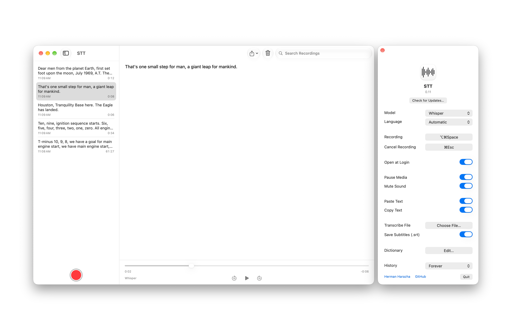

<picture><source media="(prefers-color-scheme: dark)" srcset="docs/icon-github-dark.png"></picture>

# STT

Dictation app for Mac. Speech is recognized on the Mac by a local model, and the text appears where the cursor is.

<picture><source media="(prefers-color-scheme: dark)" srcset="docs/scene.webp"></picture>

Apple silicon, macOS 13 or later.

## Install

```sh
brew install geragarazagh/tap/stt
```

Or download [`STT.dmg`](https://github.com/geragarazagh/stt/releases/latest/download/STT.dmg).
